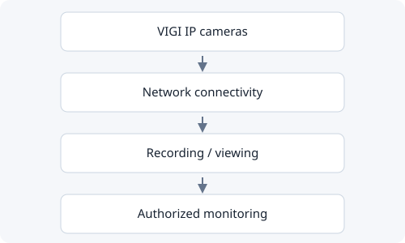

# IP CCTV Installation

**Category:** Physical security  
**Technology:** TP-Link VIGI  
**Status:** Implemented (reported)

## Business context

The project covers installation of a TP-Link VIGI CCTV solution to support physical security and visibility.

## Implementation scope

Installed TP-Link VIGI CCTV equipment. Camera models, recorder configuration and site coverage are not documented.

## Conceptual architecture

Not a verified production topology.

## Business value

Video surveillance can support premises monitoring and incident review. No measured outcomes are claimed.

## Details to confirm

Camera count, camera models, NVR or recording platform, retention period and deployment locations remain unconfirmed.
