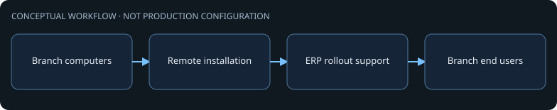

# Branch ERP Rollout Support

**Category:** Deployment support  
**Role period:** 2016–2017 · résumé role period  
**Technology:** ERP / remote IT support  
**Status:** Support engagement

## Business context

Branch computers required remote installation and technical support during an ERP rollout.

## Scope and responsibilities

- Provided remote branch computer installation for the ERP rollout.
- Provided IT support during deployment as MIS IT Unit Head.

## Conceptual workflow

Not a production configuration.

## Business value

Remote support facilitates branch adoption and deployment activities. The ERP vendor, branch count, go-live dates and deployment outcomes were not provided.

## Evidence to add when approved

- [ ] Approved rollout checklist
- [ ] Sanitized support record
- [ ] Verified scope and completion milestones

Source: supplied résumé, role-period project descriptions.
