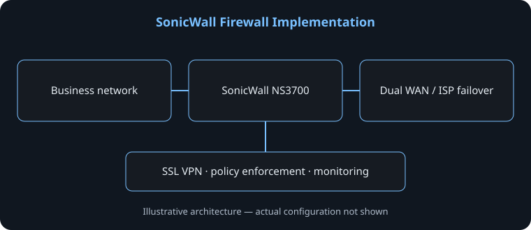

# SonicWall Firewall Implementation

**Industry:** Retail and distribution  
**Status:** Completed implementation.  
**Product:** SonicWall NS3700  
**Coverage:** 1 firewall deployed.

## Overview

Firewall-based network protection and centralized security administration for retail and distribution operations.

## Business objectives
- Protect business network boundaries against unauthorized access.
- Control network traffic according to business requirements.
- Support secure connectivity and consistent firewall administration.

## Illustrative architecture

Not an actual production topology.

## Implemented security controls
- **Access and remote connectivity:** Firewall access rules; SSL VPN.
- **Threat prevention:** Gateway Antivirus; Intrusion Prevention.
- **Traffic and content governance:** Application Control; Content Filtering; Bandwidth Management.
- **Availability and visibility:** Dual WAN / ISP Failover; Security Monitoring.

## Business value
Network boundary protection, controlled remote access and continuity during ISP disruptions are the intended benefits. No measured availability or performance improvements are claimed.

## Evidence to add
- [ ] Approved, sanitized dashboard and policy screenshots
- [ ] Implementation date and individual responsibilities
- [ ] Validation results and measured outcomes

Version, licensing and measured outcomes have not been supplied.

