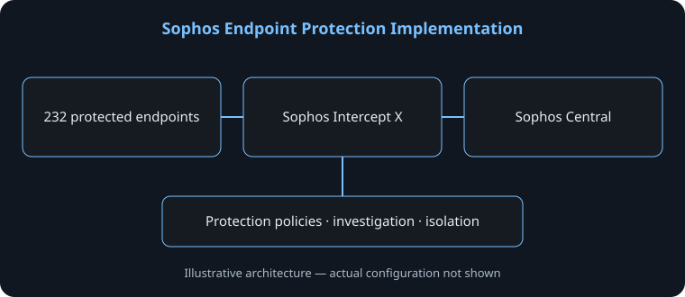

# Sophos Endpoint Protection Implementation

**Industry:** Retail and distribution  
**Status:** Completed implementation.  
**Product:** Sophos Intercept X  
**Coverage:** 232 protected endpoints.

## Overview

Endpoint security implementation to help protect business workstations and support device security administration.

## Business objectives
- Reduce exposure to malware and endpoint threats.
- Support consistent endpoint security policies.
- Improve visibility into device protection and security events.

## Illustrative architecture

Not an actual production topology.

## Implemented security controls
- **Centralized administration:** Sophos Central Management; Endpoint Health Monitoring.
- **Threat prevention:** Malware Protection; Ransomware Protection; Tamper Protection.
- **Endpoint usage policies:** Application Control; Web Control; Peripheral / USB Control.
- **Investigation and response:** Threat Investigation; Device Isolation.

## Business value
Centralized visibility, consistent device protection and incident response capabilities support security operations. No measured reduction in incidents is claimed.

## Evidence to add
- [ ] Approved, sanitized dashboard and policy screenshots
- [ ] Implementation date and individual responsibilities
- [ ] Validation results and measured outcomes

Version, licensing and measured outcomes have not been supplied.
