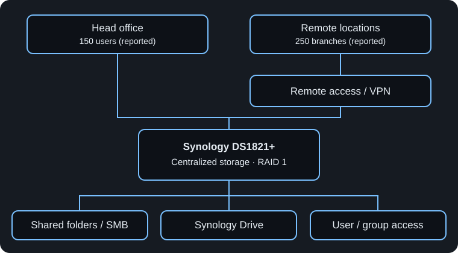

# Centralized NAS Implementation — Retail and Distribution

**Project owner / portfolio author:** Arjay Datuin  
**Status:** Completed  
**Platform:** Synology DS1821+

## Overview

Implemented centralized network attached storage to provide business file access in a distributed retail environment. Reported scope: 150 head office users and 250 branches.

## Technical details

| Item | Reported configuration |
|---|---|
| NAS | Synology DS1821+ |
| Capacity | 19 (unit and raw/usable designation to confirm) |
| RAID | RAID 1 (reported; verify storage pool details) |
| File services | SMB, shared folders, Synology Drive |
| Remote connectivity | Remote access / VPN |
| Authorization | User and group permissions |

## Logical architecture

This is a conceptual diagram, not the production network topology.

## Business objectives and value

- Centralized file access and administration.
- Authorized remote access for distributed operations.
- File permissions managed by user and group.
- Disk redundancy through the reported RAID configuration.

No measured results, independent backup configuration, DSM version or recovery testing have been supplied. RAID is not an independent backup.

